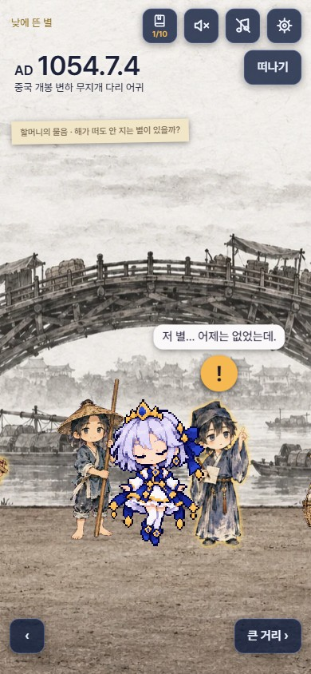
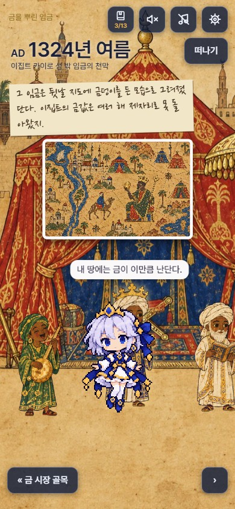
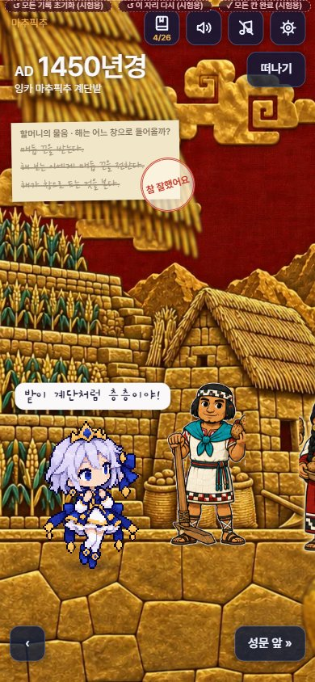
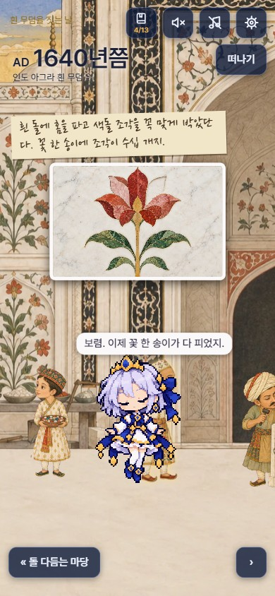
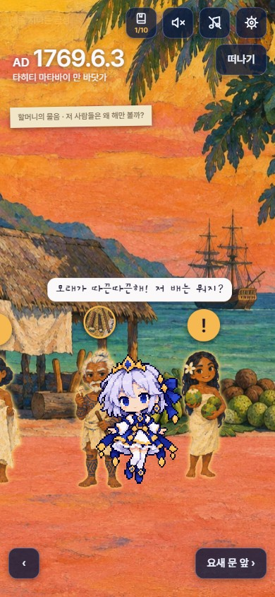
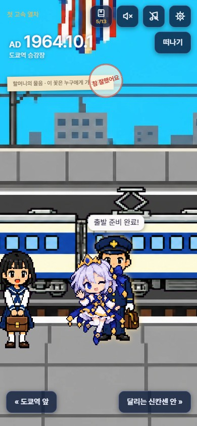
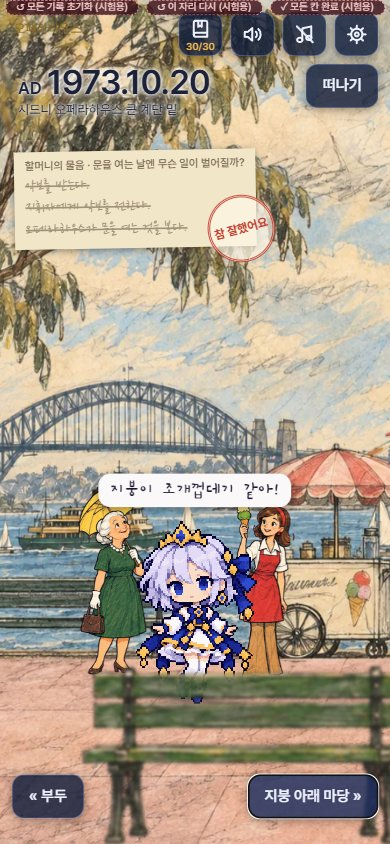

# Time Oddity — 시간 한량

할머니의 수첩을 들고 지난 날로 가서, 그날 그 거리를 걸어 다니며 사람들에게 말을 걸어 보는 교육용 게임이다.
[Space Oddity — 우주 한량](https://github.com/destory1984/oddity_claude)(1권)의 다음 편이다. 1권이 "못 가는 곳"이었다면 2권은 "못 가는 때"다.

## 플레이 스토어에 올리기 전까지 임시로 플레이해보기

- 열어 보기: https://destory1984.github.io/time-oddity_claude/play/
- 한국어, 영어, 일본어, 중국어로 할 수 있다. 설정(톱니바퀴)의 Options에서 고른다. 영어, 일본어, 중국어는 번역 모델이 옮긴 것이고 사람이 다 읽어 보지는 않았다. 어색한 문장을 찾으면 이슈에 적어 주면 고친다.
- 아직 시험하는 중이라 화면 맨 위에 시험용 단추 셋이 보인다: "모든 기록 초기화"(수첩을 비우고 처음부터), "이 자리 다시"(지금 선 곳의 이야기만 처음으로), "모든 칸 완료". 시험이 끝나면 숨긴다.
- 휴대폰으로 열면 화면에 딱 맞는다. 앱을 깔거나 가입할 필요가 없고 광고도 없다. 어디까지 했는지는 그 휴대폰에만 저장된다.
- 지금 판은 v0.2.73이다(2026.10.15). 갈 곳은 쉰둘이고, 한 곳을 다 보는 데 5분쯤 걸린다.

| 로마 제국 - 로마 AD 80 | 송나라 - 개봉 AD 1054 | 이집트 맘루크 왕조 - 카이로 AD 1324 | 잉카 - 마추픽추 AD 1450 |
|---|---|---|---|
|  |  |  |  |

| 무굴 제국 - 아그라 AD 1640 | 타히티 - 마타바이 만 AD 1769 | 일본 - 도쿄 AD 1964 | 오스트레일리아 - 시드니 AD 1973 |
|---|---|---|---|
|  |  |  |  |

## 지금 있는 것

| 때 | 곳 | 장면 셋 |
|---|---|---|
| BC 9500년쯤 | 터키 - 괴베클리 테페 | 언덕 아래 움막 터, 돌 떼는 자리와 돌 끄는 길, 둥근 돌담 앞 |
| BC 2560년경 | 이집트 - 기자 | 물길의 나루, 일꾼 마을, 피라미드 발치 |
| BC 2500년경 | 영국 - 스톤헨지 | 강가의 마을, 돌 끄는 길, 돌 고리 앞 |
| BC 776년 여름 | 그리스 - 올림피아 | 올리브 숲의 천막 터, 제우스의 제단 앞, 달리기 터 |
| BC 575년쯤 | 바빌론 | 강가 나루, 행렬 길, 이슈타르 문 앞 |
| BC 518년경 | 페르시아 - 페르세폴리스 | 사신들의 천막 터, 돌 깎는 마당, 큰 계단 앞 |
| BC 432년경 | 그리스 - 아테네 | 아고라, 언덕 오르는 길, 파르테논 앞 |
| BC 280년경 | 이집트 - 알렉산드리아 | 큰 항구 부두, 도서관 앞 길, 등대 둑길 |
| BC 210년쯤 | 진나라 - 함양 동쪽 여산 | 흙 병사 빚는 터, 칠하는 터, 세우는 구덩이 |
| AD 80년 | 로마 제국 - 로마 | 시장 거리, 콜로세움 앞 광장, 콜로세움 안 |
| AD 200년쯤 | 멕시코 - 테오티우아칸 | 큰길 어귀 좌판, 벽 그리는 집 앞, 태양의 피라미드 발치 |
| AD 537.12.27 | 동로마 제국 - 콘스탄티노플 | 하기아 소피아 앞 광장, 성당 문간, 돔 아래 |
| AD 640년경 | 신라 - 서라벌 | 저잣거리, 무덤 사이 길, 첨성대 앞 |
| AD 752.5.26 | 일본 - 나라 | 절 문 앞, 회랑 마당, 큰 부처 집 앞 |
| AD 825년쯤 | 인도네시아 - 자바 보로부두르 | 절 아래 마을 어귀, 돌 깎는 마당, 맨 아래 층 돌길 |
| AD 830년쯤 | 아바스 왕조 - 바그다드 | 책 시장, 책 집 안뜰, 별 보는 터 |
| AD 1000년쯤 봄 | 마야 - 치첸이트사 | 시장, 달팽이 집 앞, 피라미드 발치 |
| AD 1054.7.4 | 송나라 - 개봉 | 변하 무지개 다리 어귀, 성 안 큰 거리, 천문대 마당 |
| AD 1150년쯤 | 크메르 - 앙코르 | 해자 앞, 둑길, 회랑 앞 |
| AD 1324년 여름 | 이집트 맘루크 왕조 - 카이로 | 성문 앞 시장, 금 시장 골목, 성 밖 임금의 천막 |
| AD 1327년 | 말리 - 팀북투 | 낙타 닿은 장터, 흙 이기는 마당, 진흙 모스크 벽 아래 |
| AD 1350년쯤 | 그레이트 짐바브웨 | 큰 울타리 앞, 두 담 사이 좁은 길, 원뿔 탑 앞 |
| AD 1377년 여름 | 고려 - 청주 흥덕사 | 종이 뜨는 냇가, 쇳물 붓는 마당, 법당 옆 책 찍는 자리 |
| AD 1405년 | 명나라 - 난징 | 조선소 앞 강가, 짐 싣는 창고 앞, 큰 배가 매인 부두 |
| AD 1420년 겨울 | 명나라 - 베이징 자금성 | 나무 쌓은 마당, 금 벽돌 닦는 마당, 큰 전각 앞 |
| AD 1428년쯤 | 티무르 제국 - 사마르칸트 | 학교 앞, 언덕길, 천문대의 눈금 길 앞 |
| AD 1436.3.25 | 피렌체 공화국 - 피렌체 | 빵집 앞 광장, 돔 일꾼들의 마당, 대성당 문 앞 |
| AD 1446년 가을 | 조선 - 한양 | 저잣거리, 광화문 앞, 경복궁 집현전 뜰 |
| AD 1450년경 | 잉카 - 마추픽추 | 계단밭, 성문 앞, 해의 신전 앞 |
| AD 1497년 여름 | 밀라노 공국 - 밀라노 | 코르테 베키아 뜰, 대성당 뒤 나루, 그라치에 수도원 식당 |
| AD 1504.2.29 | 자메이카 | 타이노 마을, 통나무배 바닷가, 배 얹힌 모래톱 |
| AD 1519.11.8 | 아스테카 - 테노치티틀란 | 물길 어귀, 큰 시장, 호수 위 둑길 |
| AD 1610.1.7 | 베네치아 공화국 - 파도바 | 저녁 장터, 갈릴레오의 집 앞 골목, 집 뒤뜰 |
| AD 1640년쯤 | 무굴 제국 - 아그라 | 강가 공사터, 돌 다듬는 마당, 흰 무덤 위 |
| AD 1769.6.3 | 타히티 - 마타바이 만 | 마타바이 만 바닷가, 포트 비너스 문 앞, 요새 안 관측 터 |
| AD 1783.11.21 | 프랑스 - 파리 | 열기구 공방 마당, 성으로 가는 길, 라 뮈에트 성의 뜰 |
| AD 1825.9.27 | 영국 - 달링턴 | 농가 마당, 스컨 강 돌다리, 물 넣는 철길 가 |
| AD 1851.5.1 | 영국 - 런던 수정궁 | 하이드파크 문 앞 길, 서펜타인 호숫가, 수정궁 앞 |
| AD 1879.12.31 | 미국 - 멘로파크 | 정거장 앞, 연구소 이층 작업방, 전깃불 눈길 |
| AD 1886.10.28 | 미국 - 뉴욕 | 행진 길, 신문 수레 앞, 안개 낀 부두 |
| AD 1889.5.15 | 프랑스 - 파리 | 만국박람회 입구, 에펠탑 아래, 기계관 |
| AD 1903.12.17 | 미국 - 킬데빌힐스 | 인명 구조대 앞, 얼음 낀 모래길, 형제의 캠프 |
| AD 1914.8.15 | 파나마 - 가툰 | 일꾼 마을, 갑문 아래 철길, 갑문 벽 옆 |
| AD 1919.5.29 | 프린시페 섬 | 순디 농장 부엌 마당, 카카오 말리는 마당, 망원경 마당 |
| AD 1925년 11월 | 스페인 - 바르셀로나 사그라다 파밀리아 | 일꾼 아이들의 학교 앞, 성당 작업실과 돌 마당, 탄생의 문 발치 |
| AD 1937.5.27 | 미국 - 샌프란시스코 | 금문교 어귀, 다리 위, 다리 한가운데 |
| AD 1957.10.4 | 소련 - 튜라탐(바이코누르) | 자랴 마을 군인 식당, 철길 가 초원, 발사장이 보이는 초원 초소 |
| AD 1964.10.1 | 일본 - 도쿄 | 도쿄역 앞, 승강장, 달리는 신칸센 안 |
| AD 1969.7.21 | 대한민국 - 할머니의 마을 | 마을 길, 이웃집 마당, 냇가 둑길 |
| AD 1973.10.20 | 오스트레일리아 - 시드니 | 서큘러 키 부두, 큰 계단 밑, 조개 지붕 아래 마당 |
| AD 1988.9.17 | 대한민국 - 서울 | 잠실 올림픽로, 올림픽주경기장 앞, 주경기장 안 |
| AD 2010.1.4 | 아랍에미리트 - 두바이 | 수크 알 바하르 골목, 부르즈 두바이 역 앞, 부르즈 할리파 호숫가 |

- 장면은 156개, 사람은 1,089명, 크게 보여 주는 볼거리는 281가지, 할머니의 심부름은 174개다. 먹어 보고 입어 보고 써 볼 것은 123가지고, 입어 볼 옷은 쉰한 벌이다.
- 마흔네 곳에는 이야기가 하나씩 있다. 누군가에게 물건을 받아 다른 사람에게 가져다주는 일이고, 가는 길에 한 번 막힌다. 개봉에서는 막는 문지기에게 사람들의 말에서 모은 단서를 내밀어야 문이 열린다.
- 파리(1889), 샌프란시스코, 도쿄 세 곳은 찾기 놀이다. 장면마다 그날 정말 있던 것 셋을 찾아야 다음 장면으로 넘어간다.
- 그림은 곳마다 그 땅과 그 때의 그림을 본뜬다. 로마는 폼페이의 벽화, 개봉은 송나라의 수묵화, 한양은 세종 때 찍은 책의 목판 삽화, 바빌론은 이슈타르 문의 유약 벽돌, 서라벌은 말다래의 천마 그림, 마추픽추는 금판 두드린 무늬, 진나라는 옻칠 그릇의 그림, 스톤헨지는 바위 새김 그림, 시드니는 건축가의 스케치, 프린시페는 색면으로 쪼갠 그림, 바이코누르는 소련 포스터, 두바이는 별 무늬 조각 타일을 따랐다. 소라만 어디서나 도트 그림이다.
- 배경은 세 겹이다. 먼 풍경, 거리, 눈앞의 것이 걸을 때 서로 다른 빠르기로 지나간다.
- 마야, 잉카, 바빌론처럼 낯선 문명의 스물네 곳에서는 처음 내려설 때 그 사람들이 누구인지 두 문장으로 먼저 알려 준다.
- 마흔일곱 곳에 그곳의 지금 사진이 있다. 2026.10.15에 지은 다섯 곳(키티호크, 파나마, 프린시페, 바이코누르, 두바이)은 아직 사진이 없다. 알렉산드리아의 등대는 남아 있지 않아, 그 자리에 선 카이트베이 성채의 사진을 넣었다. 청주 흥덕사는 절이 남아 있지 않아, 남은 책 직지의 사진을 넣었다.
- 게임은 기원전 9500년쯤의 괴베클리 테페에서 시작한다(갈 곳 가운데 가장 오래된 곳). 처음 열면 여는 이야기 다섯 쪽이 먼저 나온다.

## 하는 법

1. 화면 아래의 화살표 단추를 누르고 있으면 걷는다. 화면의 왼쪽이나 오른쪽을 눌러도 된다.
2. 그림 속의 임금님이나 탑처럼 가서 봐야 하는 것은 누르면 소라가 그 앞으로 걸어가서 본다.
3. 사람을 누르면 말을 건다. 한 번 더 누르면 다음 말을 한다. 곁을 지나가기만 해도 한마디씩 들린다.
4. 금빛으로 빛나는 사람에게는 볼 것이 있다. 누르면 그림이 화면 너비에 가득 차게 뜬다. 먹어 볼 것과 써 볼 것도 모두 그림으로 보여 준다. 그날 그 자리에만 있던 것을 골랐다(황제가 관중에게 던진 나무 공, 인형이 종을 치는 시계 산, 못 하나와 바꾸는 코코넛 더미, 에펠탑 위의 신문 인쇄기, 죽마를 타고 건넌 금문교, 등불처럼 빛나는 신칸센의 코, 거꾸로 온 달의 첫 화면, 하늘에 그린 오륜 등).
5. "먹어 볼래", "입어 볼래", "써 볼래" 단추가 뜨면 눌러 본다. 입어 본 옷 쉰한 벌(토가, 갓과 도포, 잉카의 알파카 옷, 진나라 옷 등)은 수첩의 옷장에 모이고 어디서든 꺼내 입는다. 그 자리를 떠나면 원래 옷으로 돌아간다.
6. 이야기가 있는 마흔네 곳에서는 받은 물건(쪽지, 꽃다발, 코코넛 등)이 소라에게 날아와 곁에 떠 있다가, 건넬 때 받는 사람에게 날아간다. 개봉에서는 하늘의 새 별을 누르면 소라가 한마디 한다.
7. 왼쪽 위 쪽지에 적힌 할머니의 심부름 셋을 다 하면 도장이 찍힌다. 이야기가 있는 곳에서는 머리 위에 "!"가 뜬 사람에게 가면 되고, 마친 일은 쪽지에 줄이 그어진다. 할머니의 쪽지가 세 장(1969, 1988, 1989) 있고, 서른 곳을 다 마치면 수첩의 마지막 장이 펼쳐진다.
8. "떠나기"를 누르면 지구 위로 올라간다. 아래 다이얼을 돌려 세기를 고르고, 금색 점을 눌러 다음 곳으로 간다. 지구 뒤쪽에 있는 곳은 지구 가장자리에 속 빈 점으로 보인다.
9. 밀라노의 수도원 식당에서는 벽화를 누르면 지금의 "최후의 만찬" 사진과 설명 넉 줄이 뜬다.
10. 어느 곳에서든 할 일을 다 마치면 그곳의 지금 사진과 설명 두세 줄이 뜬다(지금의 콜로세움, 타지마할, 마추픽추, 첨성대 등 마흔일곱 장). 아무 데나 누르면 게임으로 돌아간다. 개봉에서는 그 새 별이 남긴 게 성운을, 할머니의 마을에서는 달에 내린 자리를 보여 준다.

위쪽 단추는 수첩(심부름을 다 한 곳의 수), 효과음, 배경 음악, 설정이다. 설정에서 글자 크기를 다섯 단계로 바꾸고, 배경 음악을 다음 곡으로 넘기거나 한 곡만 되풀이한다. 지구 위에서 다 마친 곳의 점에는 ✓가 붙는다. 효과음이나 음악을 끄면 소라가 손가락을 입에 대고 "쉬잇" 한다.

## 사실에 대하여

- 날짜, 장소, 물건은 실제 있었던 것을 쓴다. 사람들은 지어낸 인물이고, 할머니와 소라도 지어낸 인물이다.
- 2026.10.8에 볼거리와 대사의 사실 주장을 웹 자료와 대조해 틀린 곳 8군데를 고쳤다(한글 자모 이름, 신칸센의 뷔페 칸, 에펠탑의 리벳 등). 서울 1988은 말을 쓰기 전에 사실부터 찾아 확인된 것만 썼다.
- 2026.10.9에 지은 타히티 1769는 말을 쓰기 전과 쓴 뒤에 두 번 찾아보고, 찾지 못한 것(섬에 쇠가 전혀 없었는지, 금성이 몇 시간에 걸쳐 지나갔는지)은 말하지 않게 고쳤다. 코코넛 심부름과 족장이 요새로 데리고 들어가는 것은 지어낸 이야기다.
- 2026.10.9에 지은 개봉 1054도 같은 차례로 지었다. 새 별이 7월 4일 새벽 동쪽 하늘에 처음 보인 것, 천문 관원 양유덕이 적은 것, 금성보다 밝아 스무사흘 동안 낮에도 보인 것은 찾아 확인했다. 생도의 쪽지, 문지기, 점쟁이는 지어낸 이야기다.
- 같은 날 지은 콘스탄티노플 537, 카이로 1324, 아그라 1640도 찾아본 것만 말하게 했다. 확인한 것: 하기아 소피아가 537년 12월 27일에 문을 연 것과 네모난 방 위에 둥근 지붕을 얹은 법, 만사 무사 일행 때문에 이집트의 금값이 떨어진 것(금 한 닢이 은 25닢에서 22닢으로), 타지마할의 글씨가 위로 갈수록 커지는 것과 색돌을 박는 법. 일행이 6만 명이었다거나 일꾼이 2만 명이었다는 숫자는 확실하지 않아 말하지 않는다. 심부름과 막는 사람, 길을 일러 주는 사람은 지어낸 이야기다. 아그라는 날이 하루로 정해지지 않아 1640년쯤의 어느 아침으로 잡았다.
- 사실과 다르게 그린 것이 있다. 타히티의 그 곶은 모래가 검은데 그림에서는 분홍빛이다. 고갱의 색을 따랐기 때문이다. 개봉의 거리는 12세기 그림 "청명상하도"의 모습을 빌렸으니 1054년보다 조금 뒤의 거리다.
- 아직 확인하지 못한 것이 있다. 1969년 7월 21일 밤에 한국의 텔레비전이 달 착륙을 다시 보여 주었는지는 자료를 찾지 못했다. 낮 생중계(첫발은 한국 시각 오전 11시 56분)는 확인했다.
- 하늘은 그림이 아니라 계산이다. 그날 그 자리의 달과 별을 계산해 지붕 뒤에 그린다. 그림체를 바꾼 열한 곳(로마, 콘스탄티노플, 개봉, 카이로, 한양, 밀라노, 아그라, 타히티, 파리, 샌프란시스코, 도쿄)은 하늘이 그림 안에 그려져 있어 계산한 하늘이 보이지 않는다.
- 지금 사진에 붙인 설명은 처음 열세 곳 가운데 콘스탄티노플의 것만 찾아 확인했다. 나머지 열두 곳의 숫자(세운 해, 높이, 속도)는 기억으로 썼고 아직 대조하지 않았다. 2026.10.13에 넣은 열세 곳의 설명 서른아홉 줄과 문명 소개는 웹 자료와 대조해 애매한 열 곳을 고쳤다(치첸이트사에 모이는 사람 수, 대피라미드가 낮아진 까닭 등).
- 2026.10.13에 지은 열두 곳(바빌론, 서라벌, 치첸이트사, 사마르칸트, 바그다드, 마추픽추, 그레이트 짐바브웨, 함양, 스톤헨지, 파도바, 파리 1783, 시드니)은 말을 쓰기 전에 큰 사실을 찾아 확인했고, 자료마다 갈리는 숫자는 어림으로 썼다(바그다드에서 잰 땅 1도는 "쉰여섯 마일 남짓", 첨성대의 돌은 "삼백예순 개쯤"). 사람과 심부름은 지어낸 것이다. 마추픽추의 날은 계산으로 정했다: 1450년의 유월 동지는 그때 달력으로 6월 12일이고 해는 동북동에서 뜬다.
- 2026.10.14에 지은 네 곳(괴베클리 테페, 올림피아, 페르세폴리스, 알렉산드리아)도 큰 사실을 찾아 확인하고 썼다. 찾아보고 바꾼 것: 알렉산드리아 등대 꼭대기의 불은 로마 때부터라는 말이 있어 이야기를 낮으로 잡고 불을 그리지 않았다. 첫 올림피아 제전의 관은 올리브였는지 확인하지 못해 "나뭇가지 관"이라고 썼다. 페르세폴리스 계단의 새김은 기원전 518년에는 아직 없어 "금을 긋는 중"으로 그렸다. 괴베클리 테페가 무엇에 쓰인 곳인지는 지금도 갈려서 말하지 않는다. 사람과 심부름은 지어낸 것이다.
- 같은 날 지은 둘째 묶음 네 곳(테오티우아칸, 보로부두르, 팀북투, 청주 흥덕사)도 큰 사실을 찾아 확인하고 썼다. 찾아보고 바꾼 것: 테오티우아칸이라는 이름은 몇백 년 뒤 아스테카 사람들이 붙인 것이라 그때 사람들은 "큰 언덕", "큰길"이라고만 부른다. 피라미드 꼭대기에 무엇이 있었는지는 자료가 갈려 그리지 않았다. 팀북투에서 책을 들여와 베끼는 일은 15세기부터 많아졌기에 1327년의 장터에는 책 파는 자리를 두지 않았다. 직지는 "세계 처음"이 아니라 "쇠 글자로 찍어 지금 남은 책 가운데 가장 오래된 것"으로 쓴다. 사람과 심부름은 지어낸 것이다.
- 같은 날 사용자가 더한 사그라다 파밀리아 1925년 11월도 큰 사실을 찾아 확인하고 썼다(바르나바 종탑의 꼭지를 다 올린 달, 석고 모형으로 지은 것, 기부금으로만 짓는 성당, 일꾼 아이들의 학교). 가우디는 말을 걸 수 없는 먼발치 자리로만 두었다. 가우디가 했다는 "내 손님은 서두르지 않는다"는 말은 출처를 찾지 못해 쓰지 않았다. 사람과 심부름은 지어낸 것이다.
- 2026.10.14 저녁부터 10.15 새벽까지 지은 열세 곳(난징, 자금성, 피렌체, 자메이카, 달링턴, 수정궁, 멘로파크, 뉴욕, 키티호크, 파나마, 프린시페, 바이코누르, 두바이)도 큰 사실을 찾아 출처와 함께 표로 적은 뒤 썼다. 시안 그림이 그날과 다른 곳은 그림을 다시 받아 고쳤다: 자유의 여신상 얼굴을 가린 국기를 프랑스 국기로, 키티호크의 하늘을 그날처럼 흐리게, 파나마의 배에 깃발을, 바이코누르의 로켓을 하나로 줄이고 그날 밤의 달을 넣었다, 두바이를 해 진 뒤의 밤으로. 프린시페 농장의 흰 이층집은 1921년에 지었다는 자료가 있어 그림에서 지웠다. 라이트 형제, 에디슨, 에딩턴, 코롤료프 같은 이름난 사람은 말을 걸 수 없는 먼발치 자리로만 두었다. 사람과 심부름은 지어낸 것이다.
- 볼거리로 쓴 사실과 쓰지 않은 후보, 출처는 [docs/신기한-사실.md](docs/신기한-사실.md)에 있다.
- 틀린 것을 찾으면 [이슈](https://github.com/destory1984/time-oddity_claude/issues)에 적어 주면 고친다.

## 의견을 주는 법

[이슈](https://github.com/destory1984/time-oddity_claude/issues)에 적어 주면 된다. 이 세 가지가 가장 궁금하다.

1. 한 곳을 끝까지 했는가. 그만두었다면 어디서 그만두었는가.
2. "아, 그렇구나" 싶었던 것이 있었는가. 있었다면 무엇인가.
3. 어디서 무엇을 눌러야 할지 몰랐던 적이 있는가.

쓴 기기(휴대폰 이름, 브라우저)도 함께 적어 주면 좋다.

## 지키는 것

- 시간에 쫓기지 않는다. 죽지 않고, 점수가 깎이지 않는다.
- 사람이 죽는 순간은 보지 않는다.
- 서버, 계정, 광고가 없다.
- 글보다 그림이 먼저다. 지나가며 듣는 말은 25자, 말을 걸어 듣는 말은 40자, 할머니 메모는 세 줄(60자)을 넘기지 않는다.

## 직접 지어 보기

Node.js가 있어야 한다.

```bash
npm install
```

```bash
npm test
```

```bash
npm run dev
```

```bash
npm run build
```

- 코드는 `game/`, 시험은 `tests/`(292개), 지은 결과물은 `play/` 에 있다.
- Vite와 Babylon.js(지구본)로 만들었다. 소리와 배경 음악 스무 곡은 파일이 아니라 그 자리에서 만들어 낸다.
- 글은 한국어로 쓰고, 다른 세 언어는 한국어 문장을 열쇠로 한 사전(`game/src/i18n/en.json`, `ja.json`, `zh.json`, 2,972문장씩)으로 바꿔 보여 준다. 2026.10.10부터 지은 스물여섯 곳의 글 4,000문장쯤은 아직 옮기지 않아 한국어로 뜬다. `python tools/i18n.py check` 가 사전에 빠진 문장 수를 센다.
- 그림은 그림 모델에 발주해 받았다. 발주 글은 `docs/art-order-*.md` 에 있다.

## 문서

- [기획서 v7](docs/기획서-v7-서른넷-자리.md): 지금 따르는 기획서다. 자리마다 물건을 받아서, 가서, 전하는 이야기 하나를 둔다. 서른넷을 지었고 열일곱을 더 짓는다.
- [기획서 v6](docs/기획서-v6-이야기-하나씩.md): 바로 앞의 기획서다.
- [기획서 v5](docs/기획서-v5-완성판.md): 그 앞의 기획서다.
- [넘김](docs/넘김.md): 지금까지 한 일과 다음에 할 일이다. 가장 자주 고친다.
- [하늘 계산 확인](docs/하늘-계산-확인.md)
- 앞선 기획서([v1](docs/기획서-수첩-2권.md), [v2](docs/기획서-v2-열두-자리.md), [v4](docs/기획서-v4-사는-때로.md))와 처음의 화면 견본([견본 10](docs/ui-samples.html), [다이얼 시험판](docs/dial-proto.html))은 지나간 것이다. 처음에는 120곳을 서서 구경하는 게임이었고, 세 번 고쳐 지금의 걸어 다니는 게임이 되었다.

## 1권과의 관계

- 인물(소라, 할머니)과 할머니의 메모, 설정 화면의 짜임을 1권에서 잇는다.
- 2권만 해도 되게 만들었다. 여는 이야기는 1권을 몰라도 읽힌다.
- 지구 지도는 NASA Blue Marble(2004년 7월)이고 저작권이 없다.

## 라이선스

[LICENSE](LICENSE)는 두 갈래다.

- 코드와 문서는 MIT다.
- 소라 캐릭터와 그 그림은 MIT가 아니다. 모든 권리를 남겨 둔다. 1권과 같은 조건이다.

## 빌려 쓴 것

- "최후의 만찬" 사진: 위키미디어 공용의 `Última Cena - Da Vinci 5.jpg`. 1498년에 끝난 그림을 그대로 찍은 것이라 공개 저작물이다. 가로 1280px로 줄여 `game/public/walks/milan1497/photo-supper.webp` 에 넣었다.
- 서른 곳의 지금 사진(2026.10.13에 열일곱 곳을 더했다): 모두 위키미디어 공용에서 받았다. 가로 1280px 판(에펠탑은 800px)을 WebP로 바꿔 `game/public/walks/<곳>/photo-now.webp` 에 넣었다. 자르거나 고치지 않았다. 사진 파일은 저마다 아래 라이선스를 따른다.

| 곳 | 파일 | 찍은 이 | 라이선스 |
|---|---|---|---|
| 로마 | [Rom (IT), Kolosseum -- 2024 -- 0610.jpg](https://commons.wikimedia.org/wiki/File:Rom_%28IT%29,_Kolosseum_--_2024_--_0610.jpg) | Anil Öztas | CC BY 4.0 |
| 콘스탄티노플 | [Hagia Sophia Mars 2013.jpg](https://commons.wikimedia.org/wiki/File:Hagia_Sophia_Mars_2013.jpg) | Arild Vågen | CC BY-SA 3.0 |
| 콘스탄티노플(모자이크) | [Christ Pantocrator Deesis mosaic Hagia Sophia.jpg](https://commons.wikimedia.org/wiki/File:Christ_Pantocrator_Deesis_mosaic_Hagia_Sophia.jpg) | Myrabella | 공개 저작물 |
| 개봉 | [Crab Nebula.jpg](https://commons.wikimedia.org/wiki/File:Crab_Nebula.jpg) | NASA, ESA, J. Hester, A. Loll | 공개 저작물 |
| 카이로 | [Bab Zuweila, Cairo (1) (52087518412).jpg](https://commons.wikimedia.org/wiki/File:Bab_Zuweila,_Cairo_%281%29_%2852087518412%29.jpg) | Richard Mortel | CC BY 2.0 |
| 한양 | [Sujeongjeon 2018-09-05.jpg](https://commons.wikimedia.org/wiki/File:Sujeongjeon_2018-09-05.jpg) | De-Shao Liu | CC BY-SA 4.0 |
| 밀라노 | [Santa Maria delle Grazie (Milan) Apse exterior 07.JPG](https://commons.wikimedia.org/wiki/File:Santa_Maria_delle_Grazie_%28Milan%29_Apse_exterior_07.JPG) | Carlo Dell’Orto | CC BY-SA 3.0 |
| 아그라 | [Taj Mahal, Agra, India edit2.jpg](https://commons.wikimedia.org/wiki/File:Taj_Mahal,_Agra,_India_edit2.jpg) | Yann, King of Hearts | CC BY-SA 4.0 |
| 타히티 | [Plage pointe Vénus.jpg](https://commons.wikimedia.org/wiki/File:Plage_pointe_Vénus.jpg) | Saga70 | CC BY-SA 4.0 |
| 파리 | [Tour Eiffel Wikimedia Commons.jpg](https://commons.wikimedia.org/wiki/File:Tour_Eiffel_Wikimedia_Commons.jpg) | Benh LIEU SONG | 공개 저작물 |
| 샌프란시스코 | [Golden Gate Bridge as seen from Marshall’s Beach, March 2018.jpg](https://commons.wikimedia.org/wiki/File:Golden_Gate_Bridge_as_seen_from_Marshall%E2%80%99s_Beach,_March_2018.jpg) | Frank Schulenburg | CC BY-SA 4.0 |
| 도쿄 | [Tokaido Shinkansen N700S & N700A in Tokyo Station.jpg](https://commons.wikimedia.org/wiki/File:Tokaido_Shinkansen_N700S_%26_N700A_in_Tokyo_Station.jpg) | 電車(新幹線)でゴー！ | CC BY-SA 4.0 |
| 할머니의 마을 | [LRO Apollo11 landing site 369440main lroc apollo11 lrg.jpg](https://commons.wikimedia.org/wiki/File:LRO_Apollo11_landing_site_369440main_lroc_apollo11_lrg.jpg) | NASA, GSFC, 애리조나 주립대 | 공개 저작물 |
| 서울 | [Seoul Sports Complex.jpg](https://commons.wikimedia.org/wiki/File:Seoul_Sports_Complex.jpg) | Seoul Institute | CC BY 4.0 |
| 테노치티틀란 | [Templo Mayor, México D.F., México, 2013-10-16, DD 111.JPG](https://commons.wikimedia.org/wiki/File:Templo_Mayor%2C_M%C3%A9xico_D.F.%2C_M%C3%A9xico%2C_2013-10-16%2C_DD_111.JPG) | Diego Delso | CC BY-SA 3.0 |
| 기자 | [Great Pyramid of Giza.jpg](https://commons.wikimedia.org/wiki/File:Great_Pyramid_of_Giza.jpg) | kallerna | CC BY-SA 3.0 |
| 나라 | [Nara Todai-ji Daibutsuden Interior Daibutsu 05.jpg](https://commons.wikimedia.org/wiki/File:Nara_Todai-ji_Daibutsuden_Interior_Daibutsu_05.jpg) | Zairon | CC BY 4.0 |
| 나라(기둥 구멍) | [Pillar in Todaiji-Temple in Nara Japan.jpg](https://commons.wikimedia.org/wiki/File:Pillar_in_Todaiji-Temple_in_Nara_Japan.jpg) | Kucharek | CC BY-SA 3.0 |
| 아테네 | [Attica 06-13 Athens 35 Parthenon.jpg](https://commons.wikimedia.org/wiki/File:Attica_06-13_Athens_35_Parthenon.jpg) | A.Savin | CC BY-SA 3.0 |
| 앙코르 | [Angkor Wat with its reflection (cropped).jpg](https://commons.wikimedia.org/wiki/File:Angkor_Wat_with_its_reflection_%28cropped%29.jpg) | Satdeep Gill | CC BY-SA 4.0 |
| 앙코르(회랑 안) | [Cambodia-2322 (3582012570).jpg](https://commons.wikimedia.org/wiki/File:Cambodia-2322_(3582012570).jpg) | Dennis G. Jarvis | CC BY-SA 2.0 |
| 직지(쇠북) | [Heundeoksa2.jpg](https://commons.wikimedia.org/wiki/File:Heundeoksa2.jpg) | Forcoolife | CC BY-SA 3.0 |
| 바빌론 | [Ishtar gate in Pergamon museum in Berlin..jpg](https://commons.wikimedia.org/wiki/File:Ishtar_gate_in_Pergamon_museum_in_Berlin..jpg) | Radomir Vrbovsky | CC BY-SA 4.0 |
| 사마르칸트 | [Ulugh Beg Observatory inside.jpg](https://commons.wikimedia.org/wiki/File:Ulugh_Beg_Observatory_inside.jpg) | Benjamin Goetzinger | CC BY-SA 4.0 |
| 치첸이트사 | [Chichen Itza 3.jpg](https://commons.wikimedia.org/wiki/File:Chichen_Itza_3.jpg) | Daniel Schwen | CC BY-SA 4.0 |
| 서라벌 | [Cheomseongdae Observatory under blue sky in Gyeongju South Korea.jpg](https://commons.wikimedia.org/wiki/File:Cheomseongdae_Observatory_under_blue_sky_in_Gyeongju_South_Korea.jpg) | Basile Morin | CC BY-SA 4.0 |
| 서라벌(밤) | [첨성대 야경.jpg](https://commons.wikimedia.org/wiki/File:%EC%B2%A8%EC%84%B1%EB%8C%80_%EC%95%BC%EA%B2%BD.jpg) | Top6bin | CC BY-SA 4.0 |
| 바그다드 | [المدرسة المستنصرية في بغداد (3) cropped edited.jpg](https://commons.wikimedia.org/wiki/File:%D8%A7%D9%84%D9%85%D8%AF%D8%B1%D8%B3%D8%A9_%D8%A7%D9%84%D9%85%D8%B3%D8%AA%D9%86%D8%B5%D8%B1%D9%8A%D8%A9_%D9%81%D9%8A_%D8%A8%D8%BA%D8%AF%D8%A7%D8%AF_%283%29_cropped_edited.jpg) | Taisir Mahdi | CC BY-SA 4.0 |
| 함양 | [Qin Terracotta Army, Pit 1 18.jpg](https://commons.wikimedia.org/wiki/File:Qin_Terracotta_Army%2C_Pit_1_18.jpg) | Gary Lee Todd | CC0 |
| 마추픽추 | [Machu Picchu, Perú, 2015-07-30, DD 47.JPG](https://commons.wikimedia.org/wiki/File:Machu_Picchu%2C_Per%C3%BA%2C_2015-07-30%2C_DD_47.JPG) | Diego Delso | CC BY-SA 4.0 |
| 그레이트 짐바브웨 | [Conical Tower - Great Enclosure III (33736918448).jpg](https://commons.wikimedia.org/wiki/File:Conical_Tower_-_Great_Enclosure_III_%2833736918448%29.jpg) | Andrew Moore | CC BY-SA 2.0 |
| 스톤헨지 | [Stonehenge, Condado de Wiltshire, Inglaterra, 2014-08-12, DD 09.JPG](https://commons.wikimedia.org/wiki/File:Stonehenge%2C_Condado_de_Wiltshire%2C_Inglaterra%2C_2014-08-12%2C_DD_09.JPG) | Diego Delso | CC BY-SA 4.0 |
| 파도바 | [Galilei telescopes, Museo Galileo, Florence, Inv. 242, 2428, 224088.jpg](https://commons.wikimedia.org/wiki/File:Galilei_telescopes%2C_Museo_Galileo%2C_Florence%2C_Inv._242%2C_2428%2C_224088.jpg) | Zde | CC BY-SA 4.0 |
| 파리 1783 | [Jardin du Ranelagh, Paris 16e 32.jpg](https://commons.wikimedia.org/wiki/File:Jardin_du_Ranelagh%2C_Paris_16e_32.jpg) | Polymagou | CC BY-SA 4.0 |
| 시드니 | [Sydney Opera House - Dec 2008.jpg](https://commons.wikimedia.org/wiki/File:Sydney_Opera_House_-_Dec_2008.jpg) | Diliff | CC BY-SA 3.0 |
| 괴베클리 테페 | [Göbekli Tepe 29.05.2010 Ausgrabung 521.jpg](https://commons.wikimedia.org/wiki/File:G%C3%B6bekli_Tepe_29.05.2010_Ausgrabung_521.jpg) | Volker Höhfeld | CC BY-SA 4.0 |
| 올림피아 | [The ancient stadium, ca. 775 BC - ca. 350 BC, it could accommodate up to 40,000 spectators, Olympia (16148198000).jpg](https://commons.wikimedia.org/wiki/File:The_ancient_stadium%2C_ca._775_BC_-_ca._350_BC%2C_it_could_accommodate_up_to_40%2C000_spectators%2C_Olympia_%2816148198000%29.jpg) | Carole Raddato | CC BY-SA 2.0 |
| 페르세폴리스 | [The Apadana Staircase with the Procession of the Vassals (4686171639).jpg](https://commons.wikimedia.org/wiki/File:The_Apadana_Staircase_with_the_Procession_of_the_Vassals_%284686171639%29.jpg) | A.Davey | CC BY 2.0 |
| 알렉산드리아 | [Citadel of Qaitbay, Alexandria, Egypt.jpg](https://commons.wikimedia.org/wiki/File:Citadel_of_Qaitbay%2C_Alexandria%2C_Egypt.jpg) | Argenberg | CC BY 2.0 |
| 테오티우아칸 | [Pyramid of the Sun, Teotihuacan, from path to parking lot.jpg](https://commons.wikimedia.org/wiki/File:Pyramid_of_the_Sun%2C_Teotihuacan%2C_from_path_to_parking_lot.jpg) | Daniel Case | CC BY-SA 3.0 |
| 보로부두르 | [Borobudur-Nothwest-view.jpg](https://commons.wikimedia.org/wiki/File:Borobudur-Nothwest-view.jpg) | Gunawan Kartapranata | 공개 저작물 |
| 팀북투 | [La plus grande Mosquée de la ville de Tombouctou.jpg](https://commons.wikimedia.org/wiki/File:La_plus_grande_Mosqu%C3%A9e_de_la_ville_de_Tombouctou.jpg) | Ousmane Garba Kounta | CC BY-SA 4.0 |
| 청주 흥덕사(직지) | [Jikji pages.jpg](https://commons.wikimedia.org/wiki/File:Jikji_pages.jpg) | 찍은 이 모름 | 공개 저작물 |
| 사그라다 파밀리아 | [View of Sagrada Familia 2026.jpg](https://commons.wikimedia.org/wiki/File:View_of_Sagrada_Familia_2026.jpg) | ほっきー | 공개 저작물 |
| 난징 보선창 터 | [Nanjing Treasure Boat - P1070978.JPG](https://commons.wikimedia.org/wiki/File:Nanjing_Treasure_Boat_-_P1070978.JPG) | Vmenkov | CC BY-SA 3.0 |
| 자금성 | [Hall of Supreme Harmony (20220218132012).jpg](https://commons.wikimedia.org/wiki/File:Hall_of_Supreme_Harmony_(20220218132012).jpg) | N509FZ | CC BY-SA 4.0 |
| 피렌체 대성당 | [Cattedrale di Santa Maria del Fiore – Il Duomo di Firenze.jpg](https://commons.wikimedia.org/wiki/File:Cattedrale_di_Santa_Maria_del_Fiore_%E2%80%93_Il_Duomo_di_Firenze.jpg) | Gary Campbell-Hall | CC BY 2.0 |
| 세인트앤스 만 | [St Ann's Bay 20230605 134841.jpg](https://commons.wikimedia.org/wiki/File:St_Ann%27s_Bay_20230605_134841.jpg) | CaptJayRuffins | CC BY-SA 4.0 |
| 스컨 다리 | [Skerne Railway Bridge South Side May 2021.jpg](https://commons.wikimedia.org/wiki/File:Skerne_Railway_Bridge_South_Side_May_2021.jpg) | Verbarson | CC BY-SA 4.0 |
| 하이드파크 | [Hyde Park, Serpentine, Royal Albert Hall & Memorial 2025-03-31.jpg](https://commons.wikimedia.org/wiki/File:Hyde_Park,_Serpentine,_Royal_Albert_Hall_%26_Memorial_2025-03-31.jpg) | kitmasterbloke | CC BY 2.0 |
| 멘로파크 실험실 | [Menlo Park Laboratory of Thomas Edison site of the Invention of the light bulb.JPG](https://commons.wikimedia.org/wiki/File:Menlo_Park_Laboratory_of_Thomas_Edison_site_of_the_Invention_of_the_light_bulb.JPG) | Swampyank | CC BY 3.0 |
| 자유의 여신상 | [View of Liberty Island from the ferry, NYC, 20231003 1607 2000.jpg](https://commons.wikimedia.org/wiki/File:View_of_Liberty_Island_from_the_ferry,_NYC,_20231003_1607_2000.jpg) | Jakub Hałun | CC BY 4.0 |
| 라이트 형제 기념탑 | [Wright Brothers National Memorial landscape.jpg](https://commons.wikimedia.org/wiki/File:Wright_Brothers_National_Memorial_landscape.jpg) | Yuming Huang | CC BY-SA 4.0 |
| 가툰 갑문 | [PA-Gatun-schl-03.jpg](https://commons.wikimedia.org/wiki/File:PA-Gatun-schl-03.jpg) | Balou46 | CC BY-SA 4.0 |
| 순디 농장 | [Principe 1399.jpg](https://commons.wikimedia.org/wiki/File:Principe_1399.jpg) | César J. Pollo | CC BY-SA 4.0 |
| 가가린 발사대 | [Soyuz TMA-10M spacecraft at the Baikonur Cosmodrome launch pad (4).jpg](https://commons.wikimedia.org/wiki/File:Soyuz_TMA-10M_spacecraft_at_the_Baikonur_Cosmodrome_launch_pad_(4).jpg) | Carla Cioffi | 공개 저작물 |
| 부르즈 할리파 | [Dubai Skyline mit Burj Khalifa (18241030269).jpg](https://commons.wikimedia.org/wiki/File:Dubai_Skyline_mit_Burj_Khalifa_(18241030269).jpg) | Tim Reckmann | CC BY 2.0 (탑 둘레를 잘라 씀) |
